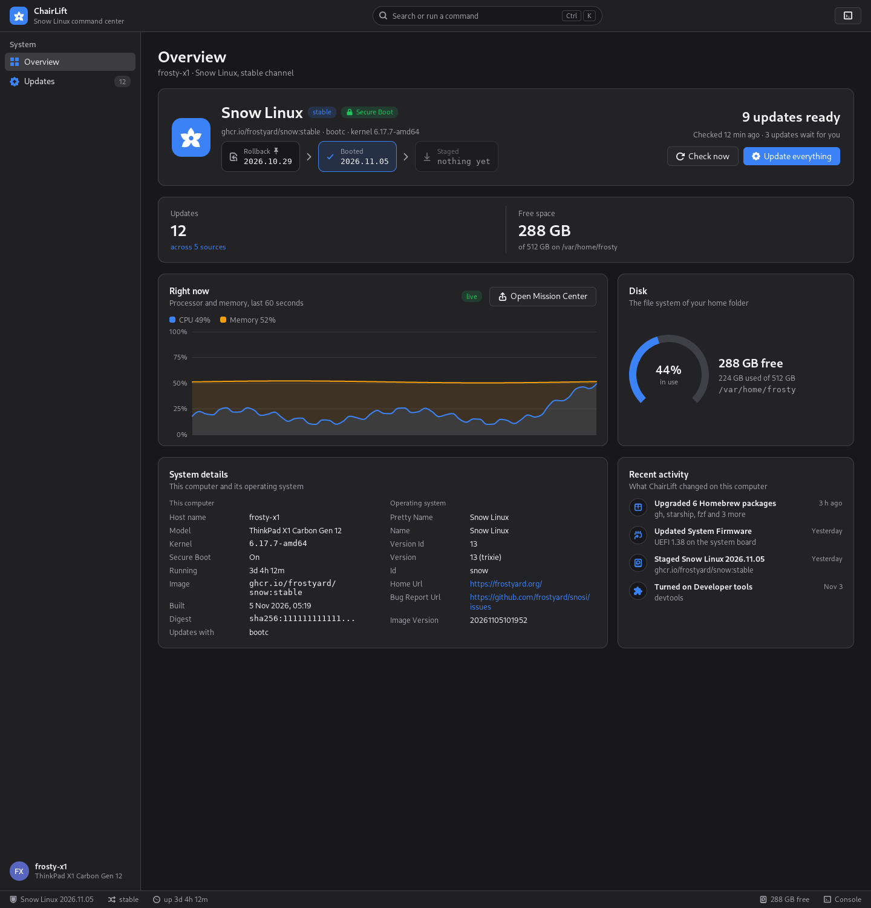
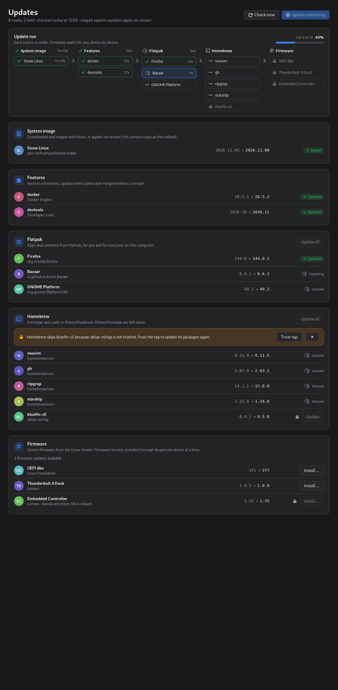

<!-- readme-kind: app -->


# ChairLift

**The command center of Snow Linux.**

ChairLift is a desktop app for people who run [Snow Linux](https://github.com/frostyard/snosi) that keeps the system image, features, apps, packages and firmware up to date and the computer tidy, from one window. It shows the commands it runs, with their output, and makes one change at a time.

**Status:** in production. Snow Linux images install it from Frostyard's APT repository.

**Documentation:** [docs/index.md](docs/index.md)



## What it does

- **Overview.** The running image and its deployment chain, the updates waiting, live processor and memory use, free space, and what ChairLift changed recently.
- **Updates.** One run across the system image (bootc or native A/B), features, Flatpak, Homebrew and firmware, with each step's state. Firmware asks first, device by device.
- **Apps.** Every installed Flatpak app and Homebrew package in one table, curated Brewfile bundles, and Homebrew search.
- **Features, Problems and Maintenance.** System extensions through updex, the problems recorded on this computer, and cleanups.
- **Command palette, console and status bar.** Ctrl K finds and runs an action, Ctrl J shows the console, and the status bar shows the running job.

Every card sits behind a configuration group, so other distributions can turn off what they do not ship: [CONFIG.md](CONFIG.md).



## Install

Each [release](https://github.com/frostyard/chairlift/releases) has packages for amd64 and arm64. Download `frostyard-chairlift` for your distribution and `checksums.txt`, check the package, and install it:

```sh
grep -F "  frostyard-chairlift_<version>_amd64.deb" checksums.txt | sha256sum --check -
sudo apt install ./frostyard-chairlift_<version>_amd64.deb   # or: sudo dnf install ./….rpm, sudo apk add --allow-untrusted ./….apk
```

Install `frostyard-chairlift-system-integration` instead only when the GUI comes from a user-scoped install such as the Homebrew cask: it holds the privileged helper, the PolicyKit policies and the default configuration. The two packages conflict. [docs/index.md](docs/index.md#installation) covers both packages and installing from source.

## Remove

```sh
sudo apt remove frostyard-chairlift   # a source install: sudo make uninstall
```

## Requirements

- At run time: GTK 3, libepoxy with an OpenGL driver (Mesa), and Pango. ChairLift loads them when its window opens; without a GPU it draws on the CPU.
- Optional, each enabling its part: `bootc` with `/usr/libexec/bootc-update-stage`, or a native A/B image with `/usr/libexec/snosi-sysupdate-stage`; updex features; Flatpak; Homebrew; fwupd; snosi-health.

## How it works

ChairLift is written in Go on [MyGo](https://mygo.egoist.dev), which draws its own widgets on GTK 3 and OpenGL loaded with purego, so it builds with no CGO. The main paths:

- `cmd/chairlift`, `cmd/chairlift-updex-helper` (the privileged helper), `cmd/chairlift-first-run` (the first-run gate)
- `internal/app` and `internal/window`: the application, the command-center window and the first-run wizard
- `internal/views`: the six pages and their state; `internal/frostui`: the UI kit
- `internal/cmdlog`: the command tracer behind the console
- `internal/homebrew`, `flatpak`, `fwupd`, `bootc`, `sysupdate`, `updex`: the backends
- `internal/config`, `navigation`, `problems`, `reporting`: configuration, pages, problem records, reports

Root actions go through `pkexec` with fixed helpers and PolicyKit policies only; nothing is passwordless. The configuration is read from `/etc/chairlift/config.yml`, then `/usr/share/chairlift/config.yml`, then `config.yml` beside the executable or in the current working directory (a development fallback). See [docs/design/overview.md](docs/design/overview.md).

## Privacy

The Problems page reads problem records on this computer and sends nothing until you turn "Send problem reports" on. Then it asks before each report, or sends automatically within a daily limit: [docs/specs/problem-reporting.md](docs/specs/problem-reporting.md).

## Credits

ChairLift began as an adaptation of [Vanilla OS First Setup](https://github.com/Vanilla-OS/first-setup). It has since been rewritten: none of First Setup's code or translations remain.

## Develop

<a id="building-from-source"></a>Go comes from `go.mod`; `mise install` provisions the pinned golangci-lint and Node.

```sh
mise install   # the pinned tools
make ci        # what CI runs
make run       # build and start the window in dry-run mode
```

Views are tested headless with MyGo's `ui.NewTester`, which needs Pango and cairo but no display. `CHAIRLIFT_SNAPSHOT_DIR=/tmp/shots go test ./internal/views -run Snapshot` writes PNGs of the pages; `make build-automation` builds a window that `mygo-automation` can drive and capture. `make e2e` starts the real window under Xvfb. [CONTRIBUTING.md](CONTRIBUTING.md) has the rest.

## Where to go next

- [AGENTS.md](AGENTS.md): the rules for agents and contributors.
- [docs/README.md](docs/README.md): the decisions, designs, specs and plans.
- [SECURITY.md](SECURITY.md): report a vulnerability privately.
- [LICENSE](LICENSE): MIT.
